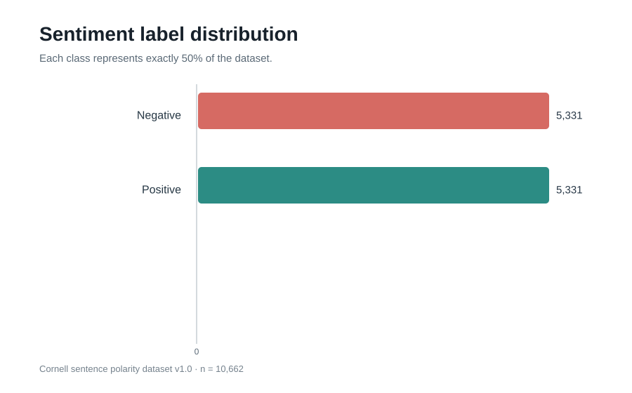
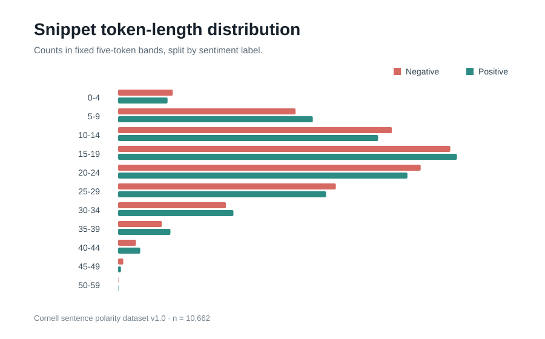
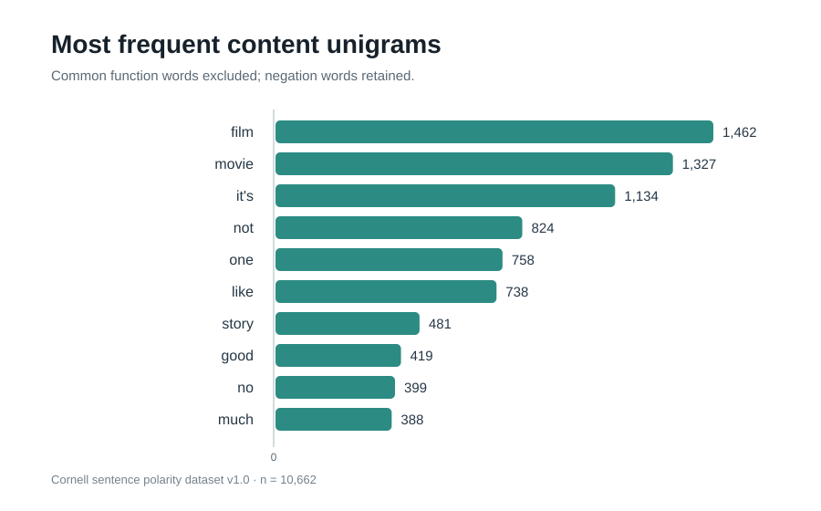
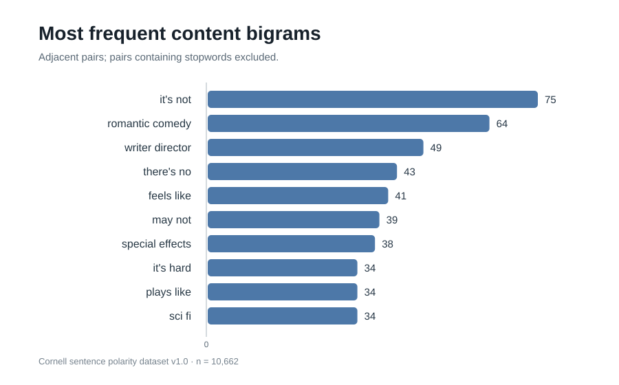
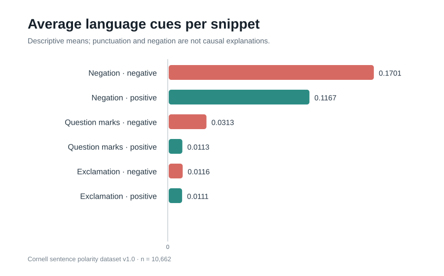

# Week 1 Technical Report: Exploratory Data Analysis & Preprocessing in NLP

**Prepared by:** Tilawath Ahmed  
**Dataset:** Cornell sentence polarity dataset v1.0  
**Domain:** Rotten Tomatoes movie-review snippets  
**Records:** 10,662 (5,331 positive; 5,331 negative)  
**Date:** 5 November 2026

## Executive summary

This project explores a public, labeled text corpus before downstream NLP modeling. The dataset is the Cornell sentence polarity dataset v1.0: a sentence-level resource containing 10,662 short Rotten Tomatoes review snippets. The corpus is balanced, with 5,331 positive and 5,331 negative snippets.

The measured corpus contains 201,517 tokens and 18,989 distinct token types under the regular-expression tokenizer documented in `eda_analysis.py`. A typical snippet contains 18 tokens (mean 18.90; median 18; interquartile range 12-25) and 111 characters at the median. No blank rows or exact duplicate raw/normalized snippets were detected. Four rows contain markup-like tags; no URL-like or email-like strings were found.

The goal is not to train a classifier in this week. The work focuses on data understanding, quality checks, transparent normalization, and outputs that can be reproduced.

## 1. Dataset overview and source

The corpus is distributed by Cornell University at the [Movie Review Data page](https://www.cs.cornell.edu/people/pabo/movie-review-data/). Cornell describes v1.0 as 5,331 positive and 5,331 negative processed sentences/snippets, introduced in Pang and Lee's 2005 ACL work and released in July 2005. This is **sentence polarity v1.0**, not the separate document-level polarity dataset v2.0, which contains 1,000 positive and 1,000 negative full reviews.

Each line is one snippet, usually approximately one sentence. The labels were assigned automatically from Rotten Tomatoes review-level Fresh/Rotten labels. This introduces possible label noise: a sentence excerpt may not express the same sentiment as the overall review.

The source files are plain text: `rt-polarity.pos` and `rt-polarity.neg`. The project script downloads the official Cornell archive first and has a public GitHub text mirror fallback. The mirror is used as a retrieval convenience, not as the dataset's primary attribution.

## 2. EDA procedure

The analysis follows these steps:

1. Load the positive and negative files separately; preserve the original text, source filename, label, and stable snippet ID.
2. Count records per class and verify the expected balance.
3. Measure raw character counts, normalized character counts, token counts, unique-token counts, and total vocabulary.
4. Inspect frequent unigrams and adjacent bigrams, both with all tokens and in a content-term view.
5. Compare token-length bands and simple punctuation/negation cues across labels.
6. Check blank rows, exact raw and normalized duplicates, markup, URLs, email-like strings, and digit-bearing snippets.
7. Export cleaned text, CSV summaries, JSON metrics, and visualizations.

## 3. Results

### 3.1 Sentiment distribution

There are 5,331 negative and 5,331 positive snippets, or 50.0% per class. The balance supports controlled class-wise comparison but should not be interpreted as the real-world prevalence of positive and negative movie opinions.



### 3.2 Text length

Across all snippets, character count ranges from 4 to 267 (mean 114.16; median 111; interquartile range 76-149). Token count ranges from 1 to 51 (mean 18.90; median 18; interquartile range 12-25). Negative snippets average 18.86 tokens and positive snippets 18.94 tokens; the difference is small.



### 3.3 Vocabulary and frequent terms

The tokenizer identifies 201,517 tokens and 18,989 distinct token types. Each snippet contains an average of 17.46 unique tokens. The most frequent content unigrams include `film` (1,462), `movie` (1,327), `it's` (1,134), `not` (824), `one` (758), `like` (738), and `story` (481). Domain terms are expected because all examples concern movies. The occurrence of `not` and `no` supports preserving negation.



Frequent adjacent content bigrams include `it's not` (75), `romantic comedy` (64), `writer director` (49), `there's no` (43), and `feels like` (41). Phrases can preserve context that isolated words miss.



### 3.4 Language cues

The mean count of negation markers is 0.170 per negative snippet and 0.117 per positive snippet. Mean question-mark counts are 0.031 and 0.011 respectively. Exclamation-mark means are similar at 0.0116 and 0.0111. These are descriptive observations, not causal claims; punctuation and negation alone do not determine sentiment.



## 4. Data quality and anomaly checks

| Check | Result | Interpretation / action |
|---|---:|---|
| Blank snippets | 0 | No empty text rows detected |
| Exact raw duplicates | 0 | No repeated original snippets found |
| Exact normalized duplicates | 0 | Normalization did not create duplicate rows |
| Rows with markup-like tags | 4 | Tag syntax is removed; visible text is retained |
| URL-like strings | 0 | No URL substitutions required in this corpus |
| Email-like strings | 0 | No email substitutions required |
| Rows containing digits | 559 | Digits are retained as potentially meaningful references |
| Exclamation marks | 121 total | Retained as a style cue |
| Question marks | 227 total | Retained as a style cue |
| Negation markers | 1,529 total | Retained as sentiment-bearing language |

The shortest and longest snippets (1 and 51 tokens) are treated as observations rather than automatically deleted outliers. Very short text may be a fragment; longer text may contain multiple clauses. Any filtering should be justified by an explicit modeling experiment.

## 5. Cleaning, tokenization, and normalization

The workflow is intentionally conservative and keeps both the source text and a separate normalized text field.

1. **Load and label:** read the positive and negative files separately, infer the class from the source file, and assign stable IDs.
2. **Lowercase:** lowercase all text. The source snippets are already down-cased, so this step makes the pipeline consistent.
3. **URL/email handling:** replace URL and email-like patterns with placeholders if present. Neither type was detected in this corpus snapshot.
4. **Markup:** remove markup-like tag syntax while retaining surrounding visible words. Four rows were flagged.
5. **Character normalization:** remove most non-linguistic symbols, while retaining letters, digits, apostrophes, and selected punctuation (`! ? . , ; :`).
6. **Whitespace:** collapse repeated whitespace and trim leading/trailing spaces.
7. **Tokenization:** use `[a-z]+(?:'[a-z]+)?|\d+` to retain alphabetic words, simple contractions, and numbers.
8. **Feature summaries:** calculate token counts, unique-token counts, negation counts, and punctuation counts. Stopword removal is limited to derived content-frequency views; it is not applied to the main normalized text.

Stemming and lemmatization are not applied at this stage. Keeping the original token forms creates a clean baseline for later comparisons and avoids changing the text more than necessary.

## 6. Challenges and mitigation

- **Automatic labels:** snippet sentiment may not match the overall review's Fresh/Rotten rating. Treat the labels as potentially noisy and inspect model errors later.
- **Short context:** sarcasm, contrast, and references may depend on surrounding sentences. Test contextual models only after establishing a simple baseline.
- **Negation scope:** `not`, `no`, and contractions can reverse polarity. Preserve these terms and compare unigram versus bigram features.
- **Rare vocabulary:** names and domain-specific terms expand the vocabulary. Use regularized TF-IDF baselines and consider character/subword features.
- **Punctuation and digits:** aggressive cleanup could delete useful style, year, age, or duration information. Retain them unless a controlled experiment shows a benefit from removal.
- **Preprocessing leakage:** fitting a vocabulary or IDF transform on the full dataset would leak test information. Fit all feature transformations inside the training pipeline only.

## 7. Implications for future NLP modeling

A suitable next experiment is a TF-IDF vectorizer with unigram and bigram features followed by logistic regression. Use stratified train/test splitting and stratified cross-validation. Fit the vectorizer only on training folds. Report accuracy, precision, recall, F1-score, and a confusion matrix, including class-wise metrics. Inspect false positives and false negatives for negation, sarcasm, contrast, and potential label noise.

The current dataset contains binary labels only and is limited to historical English-language movie-review snippets. It does not cover neutral or mixed sentiment, multilingual text, full-document context, or current social-media writing. Validate on newer, broader review sources before making generalization claims.

## 8. Reproducibility

Install Python 3.9+ and packages listed in `requirements.txt`, then run:

```bash
python -m venv .venv
# Windows: .venv\Scripts\activate
# macOS/Linux: source .venv/bin/activate
pip install -r requirements.txt
python eda_analysis.py --download --data_dir ./data --out_dir ./outputs
```

The script produces a cleaned CSV, summary JSON, unigram/bigram CSVs, class-feature and quality-check tables, and five PNG figures. This repository also includes a measured JSON/CSV snapshot and SVG chart previews. Raw corpus text is not committed; it is obtained from the public source on demand.

## 9. Conclusion

The EDA confirms a balanced corpus of 10,662 sentence snippets with similar length distributions across sentiment classes. The tokenizer identifies 18,989 unique token types. Four rows contain markup-like tags, while no blank rows or exact duplicates are found. The chosen preprocessing preserves contractions, negation, digits, and selected punctuation to avoid removing useful sentiment information. The project provides a reproducible foundation for a leakage-safe sentiment-classification baseline.

## References

1. Cornell University. [Movie Review Data](https://www.cs.cornell.edu/people/pabo/movie-review-data/).
2. Pang, B. and Lee, L. (2005). *Seeing stars: Exploiting class relationships for sentiment categorization with respect to rating scales*. Proceedings of the ACL.
3. [Public plain-text mirror used for the measured snapshot](https://github.com/abromberg/sentiment_analysis_python/tree/master/polarityData/rt-polaritydata/).
